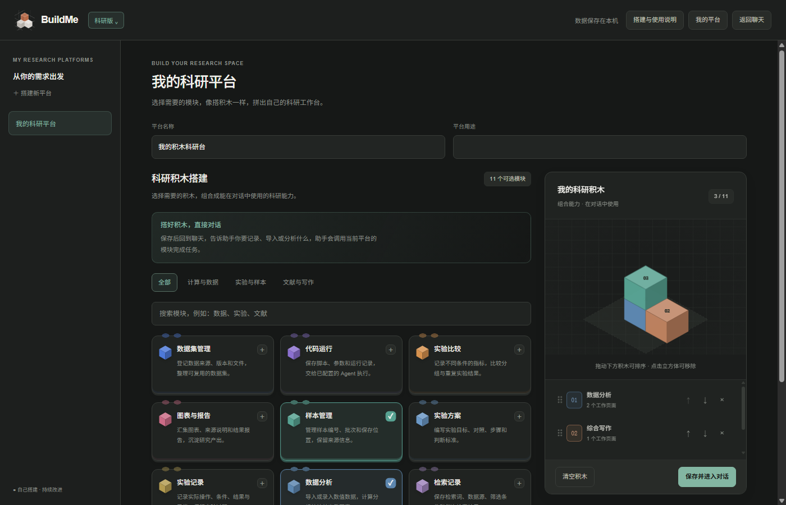
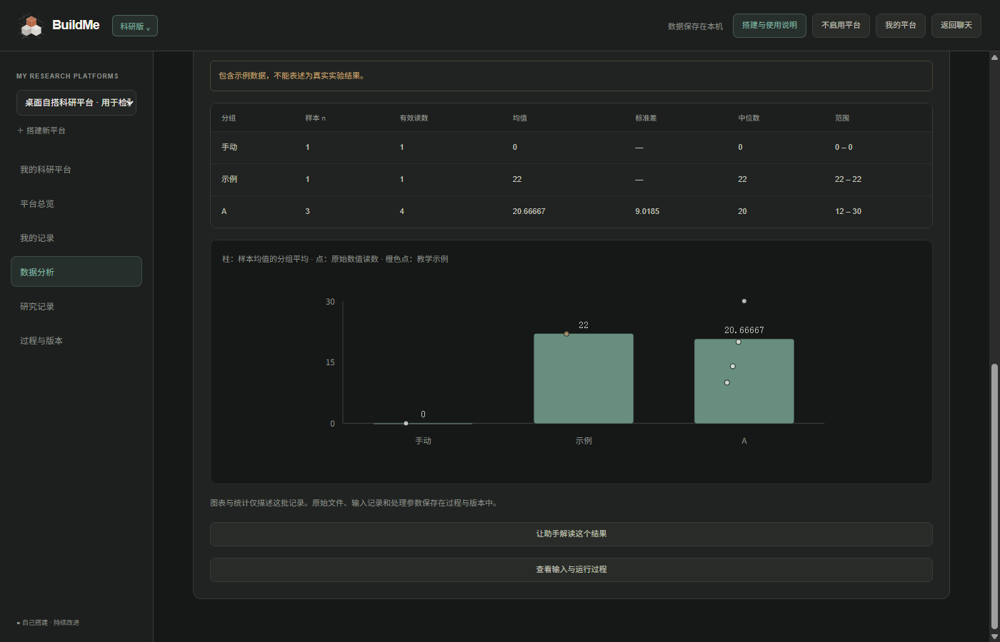

<div align="center">


**Turn AI's capabilities into your own.**

Build with an Agent. Inspect its calls. Shape its capabilities. Compare what changes.

[简体中文](README.md) · **English**

[Quick start](#quick-start) · [Research platforms](#build-your-own-research-platform) · [Product page source](docs/site/index.html) · [Report an issue](https://github.com/zixiang1118/buildme-AM/issues) · [Contribute](CONTRIBUTING.md)


</div>

---

## Why BuildMe

**BuildMe is an open-source desktop Agent workbench for doing real work and learning from the execution behind it.** Working with an Agent should help you understand how to build and use one.

Start with something you want to make: improve a project, write code, explore documents, or create a working tool. The Agent helps with the task. BuildMe lets you inspect how it selects tools, assembles context, calls a model, and uses tokens.

Enable a capability and observe the next turn. Give two Agents the same task and compare their approaches and artifacts. Bring what you learn to the next project.

**Create → Inspect → Configure → Compare → Share.**

For creators, developers, and students and teachers who learn through practice. Your own tasks set the direction; there are no fixed exams or rankings of learners' answers.

| If you are… | Start here |
|---|---|
| A developer or creator | Work in a local project, inspect tool calls, and review proposed file changes. |
| Learning how Agents work | Use the learning experience, X-ray views, capability switches, and discovery cards. |
| Comparing models or harnesses | Run two sides from the same workspace baseline and examine answers, calls, usage, and diffs. |
| A researcher or student | Build a platform for your records, datasets, analyses, notes, and workflows. |
| Building Agent infrastructure | Explore the Pi runtime, Cordis plugin assembly, DSH bridge, and example extensions. |

## What makes it different

| | What you can do |
|---|---|
| **X-ray mode** | Inspect real model calls, tool arguments and results, prompt sections, context, and subtasks. Read built-in explanations or request a deeper explanation of an event. |
| **Your Agent** | Configure nine capabilities. Tools, prompts, and runtime behavior use the same turn snapshot; changes apply to the next turn. |
| **Continuous dual chat** | Ask once; Pi and DSH stream answers side by side with separate conversation histories. Keep asking, stop runs, restore history, and compare execution and file changes. |
| **Token ledger** | Inspect reported input, output, and cache usage, tool output, and repeated context. Partial reports, estimates, and unavailable values are labeled separately. |
| **Comparison experiments** | Compare engines, two model connections, or direct reading versus searching before reading. Both sides start from independent copies of the same workspace baseline. |
| **Files in chat** | Attach images, PDF, DOCX, XLSX, text, and code. Preview and remove files before sending; both engines support attachments. |
| **Research platform builder** | Combine 11 built-in modules, create custom modules, define pages and fields, and run supported operations through chat. |
| **Learning through events** | Thirty local, deterministic achievements and discovery cards respond to actual events. Learning exports omit chat text, tool arguments, and Trace contents. |
| **Community & showcase** | A separately deployable open-source service for posts, discussions, projects, search, moderation, and sharing comparison/achievement cards. |

### Two engines. One workbench.

| | Pi · Your Agent | DSH · Full engine |
|---|---|---|
| Execution | Pi Agent Core | DeepSeek Harness native Agent loop |
| Focus | Configure capabilities and explore how they work | Explore a full harness in action |
| Extension model | Cordis plugins, prompts, Skills, capability registry | Official DSH plugins and the BuildMe bridge |
| Shared experience | Chat, workspaces, model connections, X-ray, token ledger | Chat, workspaces, model connections, X-ray, token ledger |

### Configure what your Agent can use

| Capability | Purpose |
|---|---|
| Documents | Extract readable content from supported documents. |
| Workspace search | Find relevant content before reading whole files. |
| Web reading | Fetch and read a supplied webpage. |
| To-do lists | Track task items and progress. |
| Planning | Maintain an explicit plan for a task. |
| Skills | Discover and load reusable task guidance; expose supported platform tools. |
| Context compaction | Condense conversation context as the task grows. |
| Subagents | Delegate bounded subtasks. |
| Workflows | Coordinate work through subagents. |

Basic reading, writing, editing, commands, and workspace information remain available. Workflows depend on subagents; child Agents cannot delegate indefinitely. Capability changes take effect on the next turn.

Bring your own model: DeepSeek, other supported providers, compatible APIs, or a local model service. Model availability, tool support, and reasoning output depend on your provider. BuildMe only displays reasoning actually returned by the model.

### Choose an experience for your task

| Experience | What changes |
|---|---|
| **Original** | General-purpose Agent work with your project and model connections. |
| **Learning** | Task-focused explanations of the tools and concepts you encounter, alongside X-ray, usage views, and discoveries. |
| **Research** | Your selected platform's pages, fields, assistant instructions, and workflows become available to the conversation. |

Switch from the version menu in the top-left corner. BuildMe's Pi path uses Cordis to assemble plugins around Pi's execution core. The DSH path runs its own native loop through a bridge. Their internals and event coverage differ; the interface labels partial or missing observations. See the [runtime guide](docs/runtime-guide.md) and [DSH fidelity notes](docs/xray-dsh-fidelity.md).

## A good first session

1. **Bring a project.** Select a local workspace, configure a model connection, and ask for something useful.
2. **Open an answer.** Use X-ray or the token ledger to see the calls and context behind it.
3. **Change one condition.** Enable a Skill, subagents, or compaction; inspect the next turn.
4. **Ask both sides.** Continue the conversation, compare answers, tool traces, and file diffs, then choose changes to adopt.

## Quick start

Requires **Node.js 22.19+** and **pnpm**. Use Node.js 22.x if you also run the community service.

```bash
git clone https://github.com/zixiang1118/buildme-AM.git
cd buildme-AM
pnpm install
pnpm desktop
```

`pnpm desktop` builds the TypeScript runtime and launches Electron. If you downloaded and extracted the source ZIP, open a terminal in that directory and start with `pnpm install`.

### Connect a model

Open **模型与偏好** (model preferences), add your API key, model, and endpoint, then select a local workspace.

| Connection | What to configure |
|---|---|
| A supported provider | Select the provider and enter its credentials and model. Availability depends on your account and provider. |
| OpenAI-compatible API or relay | Select **OpenAI 兼容 / 中转站** and enter the service's full base URL, model ID, and credentials. |
| Anthropic-compatible endpoint | Select **Anthropic** and use the endpoint and authentication required by that service. |
| Local model service | Use the matching supported protocol and local endpoint. Tool use and image input depend on the served model. |

Your chosen provider charges for API usage. The repository does not include shared credentials. Desktop keys are encrypted through Electron `safeStorage`; CLI credentials use the environment variables required by the configured provider. Known providers also allow manually entered model IDs using their native protocol. The desktop interface currently primarily uses Chinese; this README provides English guidance with key UI labels.

### Run a first task you can inspect

> Inspect this workspace and explain its entry points, build commands, and main directories. Cite the files you used.

Open the completed turn in **X-ray** and inspect a file-read call. Open the **token ledger** to see the usage the model actually reported. Enable workspace search or another capability, then ask a follow-up and compare the recorded steps.

For a side-by-side session, choose your two engines or model connections and submit the same prompt. Review file diffs and conflicts before adopting changes into your original workspace.

<details>
<summary><strong>CLI and desktop packaging</strong></summary>

```bash
pnpm build
node dist/cli.js init
node dist/cli.js plugins doctor
# First configure the environment variables required by your provider locally.
node dist/cli.js run "Inspect this workspace and explain the project structure"

# Default macOS target: arm64
pnpm desktop:package
# Windows x64 packaging target; not a claim of Windows runtime validation
pnpm desktop:package:win
```

See the [runtime guide](docs/runtime-guide.md) for model, profile, plugin, and connection configuration (Chinese).

The internal CLI command is named `piharness`. For a DeepSeek profile, set credentials in your own terminal before running a model request:

```powershell
# PowerShell
$env:DEEPSEEK_API_KEY = "YOUR_KEY"
```

```bash
# Bash / zsh
export DEEPSEEK_API_KEY='YOUR_KEY'
```

Match the profile's provider and model to your connection; setting a credential alone does not select a model. Profile bundles and overrides live in `.piharness/package.json` and `.piharness/cordis.patch.yml`.

```bash
node dist/cli.js plugins list
node dist/cli.js plugins graph
node dist/cli.js sessions list
node dist/cli.js profile show
```

The packaging script supports macOS and Windows targets. Outputs go to `release/`; Windows packaging produces `BuildMe-<version>-win32-x64.zip` and a `.sha256` checksum. Extract the archive and launch `BuildMe.exe`. The default macOS package runs a macOS signing step.

</details>

<details>
<summary><strong>Self-host the community</strong></summary>

The service has separate dependencies and requires Node.js 22.19–22.x. From the repository root:

```bash
cd community
pnpm install
cp .env.example .env
# Generate and set your own SESSION_SECRET following community/README.md.
pnpm build
pnpm dev
```

The service uses Hono, SQLite, and local file/OSS storage. Accounts, GitHub OAuth, domains, and production deployment require configuration. Public source availability does not imply a live public community. See the [community guide](community/README.md) and [deployment guide](community/deploy/README.md) (Chinese).

In PowerShell, use `Copy-Item .env.example .env` in place of `cp`. The community is optional for using the desktop app.

</details>

## Build your own research platform

**Your project defines the structure.** In the Research experience, open **我的科研平台** (My research platforms), to the left of Settings in the top-right corner, then enter the platform builder.

1. **Assemble:** choose modules and arrange their order using the blocks or move controls.
2. **Adapt:** edit pages, field names and types, assistant instructions, and workflow settings. Preview the generated forms.
3. **Save:** review the change summary and confirm. BuildMe selects the platform and returns to chat.
4. **Use:** ask the Agent to save records, import files, run analysis, or execute a saved workflow.

### Eleven modules to start from

| Area | Modules |
|---|---|
| Computation and data | Dataset management · Code runs · Experiment comparison · Charts and reports · Data analysis |
| Experiments and samples | Sample management · Experimental protocols · Experiment records |
| Literature and writing | Search records · Literature screening · Research writing |

Use **＋ 自定义模块** to design your own module or describe it to the configured model. AI-generated modules open as editable drafts. Preview and save the module, then save the platform before using it. Your custom modules remain in the current workspace's module library for reuse.

<details>
<summary><strong>See the platform builder and an analysis screen</strong></summary>





These screenshots come from desktop acceptance scenarios and use example data. They illustrate interface behavior and supported workflows; they are not research findings or performance benchmarks.

</details>

### Try an import → analysis → report workflow

Add the **Data analysis** module to a platform. Save this small example as `sample-readings.csv` in your selected workspace, or attach it in chat:

```csv
sample_id,group,value,notes
sample-A,control,10.2,example data
sample-A,control,10.6,repeated reading of sample-A
sample-B,control,9.8,example data
sample-C,treatment,12.1,example data
sample-D,treatment,,missing reading
```

Then send:

> Import sample-readings.csv into the current platform's Data analysis records. Run the configured grouped analysis and explain sample counts, repeated readings, and missing values. Use the actual results and label this as example data.

The built-in analysis averages repeated readings with the same sample ID within each group, then reports sample counts, means, sample standard deviations where defined, medians, and ranges. Missing values remain missing. Charts show group means and original readings. Input records, parameters, and configuration versions are retained with the run.

You can also ask:

> Run the platform's saved workflow. Report which import, analysis, and report steps actually completed, and explain any missing configuration.

To adapt the structure:

> Add an equipment ID field to the current platform and check its analysis and workflow references. Preserve existing records and submit a draft for me to review.

Platform changes proposed by an Agent remain drafts until you review and save them in the builder. Configuration restoration creates a new version while keeping current records, archived files, and run history. Export a project for backup and traceability, or export a template containing the structure without its research records.

**The built-in numerical workflow provides descriptive statistics.** It does not automatically establish statistical significance, causality, or scientific validity. Literature, chemistry, and simulation options provide assistant guidance; specialist tools and dependencies must be connected separately. The former fixed medicinal-chemistry workbench is historical and is no longer the default product workflow. See the current [platform guide](docs/platform-builder.md) for the full scope.

## Data and execution boundaries

- **Local by default.** History and configuration are stored on your machine. Relevant task contents are sent to the model provider you select; a local workbench does not imply offline inference.
- **Automatic dual execution.** Dual chat runs without per-tool approvals inside separate workspace copies. Execution-layer read-only and command isolation rules still apply. Adopting changes into original files requires a preview and conflict checks.
- **Compare observed behavior.** Using the same model helps compare harnesses, but random output differences cannot all be attributed to the harness.
- **Evidence stays honest.** Missing usage is not replaced with zero; partial usage is not presented as a full total. Provider-returned reasoning is separate from the final answer.
- **Extra calls are explicit.** Viewing local traces and achievements uses no model calls. Deep explanations, comparison summaries, and new comparison runs use your chosen model connection.
- **Single-session permissions.** `ask` requests approval for writes and commands; `workspace-write` allows workspace file operations while asking for commands; `bypass` removes approvals and workspace path restrictions.
- **Command isolation.** Comparison commands are rejected when the platform cannot provide the required isolation; this limits command execution in Windows comparisons.
- **Research records.** Platform data lives under `.buildme/platforms/` in the selected workspace. Imports archive original files and runs retain their sources. Selecting a module does not install scientific software or connect lab equipment.

## FAQ

**Is BuildMe free to use?**  
BuildMe's own code is MIT licensed. Model APIs, hosting, and other services you choose may charge separately.

**Does it work without a DeepSeek account?**  
You can configure other supported providers, compatible endpoints, or local model services. Features depend on the selected model and protocol. DSH's `web_search` specifically requires a DeepSeek key; `web_fetch` has a separate execution path.

**What can I attach?**  
PNG, JPEG, WebP, GIF, PDF, DOCX, XLSX, and supported text/code files. A send supports up to eight files, up to 40 MB combined; individual images are limited to 10 MB and documents to 20 MB. Vision requires a model that supports image input. Long documents may be truncated with a warning; scanned PDFs need OCR or image input. Spreadsheet formulas use saved results and are not recalculated.

**Can a comparison edit my original project?**  
Each side works in its own baseline-derived copy. Review the diff and explicitly adopt changes before they reach original files; adoption checks for conflicts. Snapshots exclude Git metadata, installed dependencies, symbolic links, and oversized files. The defaults skip files over 50 MB, switch snapshots over 300 MB to read-only, and expire comparison workspaces after seven days.

**Can I trust a two-side comparison as a benchmark?**  
Treat it as evidence about those runs. Prompt, context, model, sampling, tool availability, and runtime differences can affect the outcome. Even the same model can produce different results across runs.

**Does the Research experience run experiments for me?**  
It can save records, import supported tables, calculate descriptive statistics, show charts, and run its saved supported workflows. Code execution uses the Agent's configured tools and runtime. Specialist calculations, external searches, and physical experiments require the corresponding tools, data, and human verification.

**Is there a hosted community or download service?**  
This repository contains the community source and desktop packaging tools. They do not by themselves establish a live public service or a published binary release. Use source startup or your own configured deployment.

## Inside the repository

| Directory | Contents |
|---|---|
| [`desktop/`](desktop/) | Electron main process, IPC, chat, and visualizations |
| [`src/cli.ts`](src/cli.ts) | Source entry point for the `piharness` CLI |
| [`src/core/`](src/core/) | Pi runtime, Trace, capabilities, achievements, comparisons, workspaces |
| [`src/full/`](src/full/) | DSH bridge, event collection, and tool integration |
| [`src/plugins/`](src/plugins/) · [`bundles/`](bundles/) | Cordis plugins, system prompts, capability prompts |
| [`community/`](community/) | Complete community server, frontend, migrations, tests, deployment tools |
| [`test/`](test/) · [`scripts/`](scripts/) | Unit tests, isolated Electron acceptance fixtures, packaging |
| [`docs/`](docs/) | Product, architecture, requirements, implementation, and acceptance records |
| [`legal/`](legal/) | Preserved third-party licensing material |

For a deeper reading path: [product brief](docs/product-brief.md) → [architecture](docs/architecture.md) → [runtime guide](docs/runtime-guide.md) → [plugin authoring](docs/plugin-authoring.md). Most detailed guides currently use Chinese.

## Status and contributions

BuildMe is under active development. macOS arm64 has actual desktop acceptance records. Windows has a packaging target; Windows and Linux desktop runtime validation remain pending. Some cross-worker DSH subtask statistics have collection limits; see the [fidelity notes](docs/xray-dsh-fidelity.md).

Contributions are welcome: reproducible issues, interface improvements, plugins, and documentation. Read [CONTRIBUTING.md](CONTRIBUTING.md). The [feature ideas](docs/feature-ideas.md) document describes proposals, not shipped features.

```bash
pnpm test
pnpm typecheck
pnpm test:typecheck
pnpm lint
pnpm build
```

## Open source and acknowledgments

This repository is based on [jsdnaasd/buildme-agent](https://github.com/jsdnaasd/buildme-agent). The product name remains **BuildMe**. Original copyright and license notices are retained.

**The desktop app, CLI, Agent runtime, plugins, prompts, community service, tests, and project documentation are public in this repository. BuildMe's own code is [MIT licensed](LICENSE).** Local credentials, user conversations, databases, installed dependencies, and private deployment configuration are excluded from source publication.

Built with [Pi](https://github.com/earendil-works/pi), [DeepSeek Harness](https://github.com/deepseek-ai/deepseek-harness), and their ecosystems. BuildMe is an independent project. Upstream copyrights and licenses are preserved in [THIRD_PARTY_NOTICES.md](THIRD_PARTY_NOTICES.md).

<div align="center">

**Build to understand. Understand to build.**

</div>
