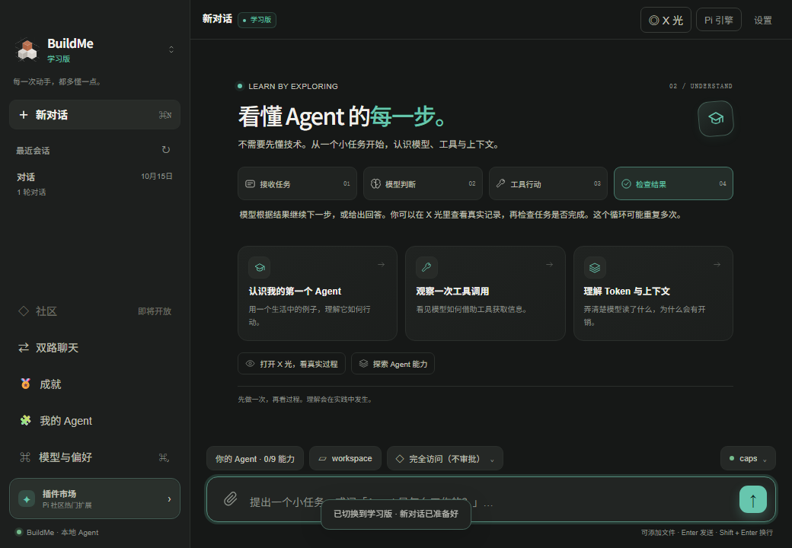

<div align="center">


# BuildMe

### 用 AI 完成任务，看懂执行过程，搭建自己的科研平台。

**双引擎执行 · X 光追踪 · 能力自由组合 · 科研平台搭建**

**BuildMe 是一款开源桌面 AI Agent 工作台。** 在本地项目中写代码、读资料、调用工具；在 X 光里查看执行依据；用科研积木，把记录、数据分析与报告组合成自己的课题平台。

**简体中文** · [English](README.en.md)

[快速开始](#快速开始) · [核心功能](#核心功能) · [使用场景](#可以拿它做什么) · [科研平台](#像搭积木一样搭建科研平台) · [常见问题](#常见问题) · [参与贡献](CONTRIBUTING.md)


[](LICENSE)

</div>

---

## 30 秒了解这版 BuildMe

这个仓库是 **`buildme-AM`，当前应用版本为 `0.4.3`**。这一版把通用 Agent 工作、边做边学和可自定义的科研平台放在同一个应用里，保留原版、学习版、科研版三种体验。

Agent 可以根据任务调用文件、命令与其他工具。BuildMe 进一步让你观察它的实际行动，调整可用能力，对照不同做法，并把课题配置和研究资料保存下来。

| 本版亮点 | 你能直接体验什么 |
| --- | --- |
| **一个任务，两条执行路径** | Pi 与 DSH 同模型对比，或在 Pi 中比较模型和读取策略；连续追问并查看过程与文件变化 |
| **回答背后的记录可以展开** | 在 X 光中查看模型调用、工具结果、提示词组成、上下文占用与已报告的 Token 用量 |
| **Agent 能力可以亲手调整** | 为 Pi 配置九项扩展能力，观察开关对下一轮工具、提示词和执行方式的影响 |
| **科研平台可以按课题搭建** | 从 11 个内置模块开始，组合页面、字段、助手和流程，也可以自己设计或让 AI 生成模块草案 |
| **搭好平台后，在对话里使用** | 请求保存记录、导入 CSV / Excel、运行描述统计、生成流程报告，再核对输入与运行依据 |

**2 个执行引擎 · 9 项可开关能力 · 3 种使用体验 · 11 个内置科研模块。**

下面的介绍以当前源码实际提供的功能为准；未来构想、历史科研资源和需要另行配置的专业工具会分别说明。

## 界面预览

**从自己的需求出发，搭建科研平台。** 选择模块、调整顺序，再保存并回到对话中使用。


<details>
<summary><strong>展开查看：学习版与数据分析界面</strong></summary>

**学习版：从一个真实任务认识 Agent。**



**科研平台：保留原始读数、分组统计与运行依据。**


</details>

以上为项目桌面验收场景截图，包含测试配置与教学示例数据，用于展示交互。它们不代表真实实验结论或性能评测。

## 快速开始

### 1. 准备环境并启动

| 准备项 | 要求 |
| --- | --- |
| Git | 用于获取源码 |
| Node.js | 桌面端要求 **22.19+**；若同时运行社区，使用 **22.19–22.x** |
| pnpm | 用于安装依赖与运行项目命令 |
| 模型连接 | 使用自己有权访问的模型服务，或自行启动的兼容本地服务 |

```bash
git clone https://github.com/zixiang1118/buildme-AM.git
cd buildme-AM
pnpm install
pnpm desktop
```

`pnpm desktop` 会先编译 TypeScript，再启动 Electron。已有源码时，在项目根目录执行最后两条命令即可。社区独立安装，首次体验桌面端不需要部署社区服务。

### 2. 配置模型，选择工作区

打开「模型与偏好」，添加一条自己的模型连接：

| 设置 | 怎么填写 |
| --- | --- |
| 连接名称 | 便于自己识别，例如“我的开发模型” |
| 服务商 | 选择与实际接口一致的提供商；兼容中转使用对应的兼容接口选项 |
| 模型 ID | 使用该连接实际有权调用的模型名称；不能只根据展示名称猜测 |
| API Key | 在本机填写自己的密钥；本地服务是否需要 Key 取决于服务配置 |
| Base URL | 按服务商或中转的接口说明填写；使用默认官方连接时按界面默认设置处理 |

保存并选中连接，再选择一个本地项目文件夹作为**工作区**。初次探索可以选择「每次询问」权限模式：只读自动进行，写入与命令需要确认。

BuildMe 不提供共享密钥。远程模型调用费用由所选服务商收取；模型的工具调用、图像输入与推理内容支持范围取决于具体接口。

### 3. 发出第一个容易核对的任务

> 请只读查看当前工作区的顶层结构和项目说明，列出项目用途、技术栈、启动与检查命令，并给出对应文件依据。找不到的内容标为待确认。

完成后，你可以检查三件事：

1. **回答有依据吗？** 启动命令是否能在项目文件中找到，缺失信息是否明确说明。
2. **过程发生了什么？** 打开右上角 **X 光**，沿「时间线」查看文件读取和工具结果。
3. **模型读入了什么？** 查看「提示词」「上下文」与「Token 账单」，区分实际报告和估算。

如果希望边做边理解术语，先切换到**学习版**。完成一次真实任务，再调整一项 Pi 能力开始下一轮，观察变化。

## 核心功能

### 看见一次回答背后的执行过程

**X 光模式**将实际采集到的回合事件展开：模型调用、工具参数与结果、提示词组成、上下文和子任务。你可以先读静态说明，再按需请求深入讲解。

| 想弄清楚的问题 | 在哪里看 |
| --- | --- |
| 这轮先做了什么，哪个工具失败了？ | **时间线**：按事件查看模型调用、工具输入输出、审批和完成状态 |
| 这一轮带入了哪些规则和能力？ | **提示词**：查看已记录的提示词组成与来源 |
| 哪些内容占了上下文？ | **上下文**：观察提示词、消息、工具定义与结果等内容的估算占比 |
| 哪次请求、哪个已记录子任务用量更多？ | **Token 账单**：分项查看模型报告与统计完整性 |
| 实际请求结构是什么？ | 进阶视图的 **原始请求**；可在「模型与偏好」控制是否记录 |

**Token 账单**展示模型报告的输入、输出和缓存用量，帮助发现大段工具输出与重复上下文。缺失、估算和部分统计分别标注；提供商没有返回的数据不会补成零。界面只展示模型实际返回的推理内容。

这里的账单单位是 **tokens**，不自动推算实际金额。判断一次运行时，先检查任务是否完成，再比较用量和路径；少用 Token 本身不代表效果更好。

### 亲手配置你的 Agent

「我的 Agent」为 **Pi / Build 执行路径**提供九项能力开关；**DSH 完全体使用自身的原生能力**。你可以从基础组合开始，再逐项添加：

| 能力 | 用途 |
| --- | --- |
| 读文档 | 提取 PDF、DOCX、HTML 与文本内容 |
| 搜索工作区 | 先定位相关文件与内容，再按需读取 |
| 读网页 | 获取和提取网页内容 |
| 任务清单 | 跟踪多步骤任务的进度 |
| 计划 | 在执行前组织任务方案 |
| Skill | 使用可复用的任务说明与专业工作方法 |
| 上下文压缩 | 为较长对话整理上下文 |
| 子 Agent | 将适合拆分的任务交给子任务处理 |
| 工作流 | 组织多个子任务的执行流程 |

工具、提示词与运行时共用同一份回合配置，开关修改在**下一轮**生效。基础文件读写、编辑、命令与工作区信息能力始终保留；工作流依赖子 Agent，子任务不会无限继续委派。

### 同一个问题，同时走两条路径

双路聊天使用一个输入框，左右两侧分别流式回答、保留上下文。你可以持续追问、停止运行、恢复历史，并查看文件 diff 与执行轨迹。在「双路聊天」→「设置」中选择：

| 对比方式 | 两侧分别是什么 | 适合观察 |
| --- | --- | --- |
| 同模型 · Pi 与 DSH | 使用同一模型连接的 Pi 与 DSH | 两种执行框架的工具路径、任务产物与已报告用量 |
| 同 Pi 能力 · 两个模型 | 同一套 Pi 能力，使用两条模型连接 | 不同模型在同一任务中的表现 |
| 同模型 · 两种读取策略 | 两侧均使用 Pi，比较直接读取与先搜索再读取 | 文件定位方式、读入内容与上下文占用 |

两侧从相同工作区基线建立独立副本，采用改动前展示差异并检查冲突。创建后的会话沿用当时的模型与能力配置；要更换条件，请新建双路会话。同一模型仍可能产生随机差异，比较时应结合任务与实际产物判断。

模型对比需要明确选择两条不同连接；读取策略对比会为两侧临时启用搜索能力，以构造对应实验条件。

### 把资料直接带入对话

点击输入框左侧的回形针，添加图片、PDF、Word `.docx`、Excel `.xlsx` 或文本、代码文件。发送前可以预览或移除，Pi 与 DSH 都支持附件。

图片需要支持视觉的模型；扫描版 PDF 需要先做 OCR。Excel 读取已有公式结果，不执行公式重算。具体格式与大小限制见[运行指南](docs/runtime-guide.md#给-ai-添加文件)。

### 把一次探索沉淀下来

30 项本地确定性成就与发现卡由真实事件触发。学习记录可导出，导出内容不包含聊天正文、工具参数或 Trace 内容。社区与作品墙提供帖子、讨论、作品、搜索、审核和对比/成就分享，社区服务可独立部署。

## 两个引擎，三种体验

### 选择执行引擎

| | Pi · 你的 Agent | DSH · 完全体 |
| --- | --- | --- |
| 执行内核 | Pi Agent Core | DeepSeek Harness 原生 Agent loop |
| 适合场景 | 调整能力、观察机制、做受控实验 | 体验完整 harness 的执行方式 |
| 扩展方式 | Cordis 插件、提示词、Skill 与能力注册表 | 官方 DSH 插件与 BuildMe bridge |
| 共用体验 | 聊天、工作区、模型连接、X 光、Token 账单 | 聊天、工作区、模型连接、X 光、Token 账单 |

模型连接由你选择，支持 DeepSeek、Pi 模型目录中的提供商，以及兼容接口或本地模型服务。实际模型、工具调用、图片输入和推理内容支持范围取决于服务商及接口。

### 选择使用体验

| 体验 | 从哪里开始 |
| --- | --- |
| **原版** | 专注任务本身，使用聊天、工作区和工具 |
| **学习版** | 在完成任务的同时，获得与当前操作有关的简明讲解，再展开 X 光验证 |
| **科研版** | 通过「我的科研平台」搭建平台，将课题配置带入对话并调用已有平台能力 |

三种体验可以在**左上角版本菜单**中切换；Pi / DSH 在**右上角引擎入口**切换。体验决定工作方式与界面入口，引擎决定执行内核，两者是不同设置。

## 可以拿它做什么

以下是使用入口示例，实际完成情况取决于工作区资料、模型、已配置工具与权限。每个场景都可以回到 X 光或文件记录中核对结果。

| 场景与适合的人 | 怎么开始 | 可以核对的产物 |
| --- | --- | --- |
| **接手一个代码项目**：开发者、学生 | 选择项目文件夹，读取 README、配置与核心入口，整理运行方法 | 项目结构说明、启动与检查命令、依据文件 |
| **完成一个项目改动**：创作者、开发者 | 描述具体目标、范围与验收条件，让 Agent 修改文件并运行适用检查 | 实际文件 diff、运行结果、已完成和未验证事项 |
| **整理会议或项目资料**：文档使用者 | 添加 PDF / DOCX / 文本，要求提取行动项、负责人、期限与原文依据 | 带来源的行动清单，缺失项明确标记 |
| **理解 Agent 的工作机制**：初学者、教师 | 使用学习版，观察一次工具调用，再改变一项 Pi 能力 | 可回看的执行事件、提示词变化与探索记录 |
| **选择模型或读取方式**：Agent 开发者 | 在双路聊天中固定任务条件，比较模型或读取策略 | 两侧回答、执行轨迹、已报告用量与文件变化 |
| **整理课题数据与流程**：研究人员、学生 | 用科研模块定义记录，导入表格，运行描述统计与报告 | 数据记录、图表、运行输入、配置版本与课题导出 |

<details>
<summary><strong>复制就能试：三个任务提示词</strong></summary>

**项目开发：先说明目标与验收条件。** 将方括号替换为你的需求：

> 请在当前项目中完成[具体改动]，范围限定在[相关页面或模块]。先检查现有实现，再说明方案并修改；完成后运行项目已有且适用的检查，列出变更文件、实际验证结果和待验证事项。

**资料整理：把“结论”与“依据”一起要出来。**

> 请根据附件整理行动项表格，列出事项、负责人、期限和原文依据；附件未明确说明的标为待确认。最后列出需要进一步澄清的问题。

**Agent 学习：用当前任务理解术语。**

> 请查看这个项目，并在执行过程中简短解释为什么选择当前工具。完成后用本轮实际发生的操作说明模型、工具、上下文和验证分别发挥了什么作用。

</details>

### 第一次双路对比，建议从只读任务开始

1. 选择一个已有代码项目作为工作区，打开侧栏「双路聊天」。
2. 在「设置」选择「同模型 · Pi 与 DSH」，选定两侧共用的模型连接；可以保留当前 Pi 能力，或选择「本次开启 Pi 全部能力」。
3. 发送快速开始中的只读项目分析请求，再用同一个输入框继续追问：“请分别说明判断依据，并列出尚未读取、可能影响结论的文件。”
4. 打开「对比结果」，对照回答依据、工具轨迹和已报告的 Token；涉及写入的后续任务，再查看文件差异并决定是否采用。

可以带着一个问题观察：**哪一侧更快定位了有效信息，哪一侧读入了更多无关内容？** 这是探索路径，不预设胜负，也不承诺固定节省比例。

## 像搭积木一样搭建科研平台

科研版不预设学科，也不要求所有课题采用同一流程。你可以为不同课题建立独立的平台，自己决定页面、字段、助手职责和处理步骤。

### 11 个模块，自由组合

| 模块 | 具体保存与使用什么 | 典型用途 |
| --- | --- | --- |
| **数据集管理** | 名称、版本、来源、文件格式、数据量与说明 | 为多个数据文件建立目录与来源记录 |
| **代码运行** | 脚本或命令、参数、环境、状态与执行日志 | 整理分析脚本和运行依据，再交给已配置的 Agent 执行 |
| **实验比较** | 样本 / 运行编号、分组 / 方法、数值指标及分析页面 | 比较不同条件或方法的描述统计 |
| **图表与报告** | 标题、报告正文、数据来源与结果限制 | 汇集图表说明与阶段性研究产出 |
| **样本管理** | 样本编号、来源、批次、位置、日期与备注 | 管理样本台账并保留来源信息 |
| **实验方案** | 目标 / 假设、变量与对照、步骤、判断标准 | 保存和讨论实验设计草案 |
| **实验记录** | 实验编号、方案、样本、日期、条件、读数与异常 | 记录真实操作和后续需要解释的问题 |
| **数据分析** | 数据记录页与结果页，关联数值、分组和样本字段 | 导入表格后运行描述统计与图表 |
| **检索记录** | 检索式、数据源、日期、筛选范围、数量与来源链接 | 保存每次检索的条件与过程 |
| **文献筛选** | 题名、作者、年份、DOI / 链接、筛选结论与依据 | 组织纳入、排除和待定文献 |
| **综合写作** | 章节草稿、证据与引用、待核对内容 | 将资料与论述组织为可修改的写作记录 |

例如，**课程实验**可以组合「实验方案＋实验记录＋数据分析」，**方法比较**可以组合「数据集管理＋代码运行＋实验比较」，**文献整理**可以组合「检索记录＋文献筛选＋综合写作」。这些组合提供记录结构与已有能力；联网检索和专业软件仍需要实际配置。

还可以创建**自定义模块**：自己设计页面与字段，或描述需求让 AI 生成可编辑草案。模块可在当前工作区复用，AI 草案经你预览、修改并确认后才保存。

### 第一次搭建，按这四步操作

1. 切换到**科研版**，打开右上角「我的科研平台」→「搭建与管理平台」→「＋ 搭建新平台」，进入完整搭建器。
2. 选择「数据分析」等模块，拖动积木调整顺序，在「页面与字段」检查名称、类型和单位。
3. 在「使用预览」核对表单，点击「保存并进入对话」，确认后启用平台。
4. 添加 CSV、TSV 或 XLSX 附件，直接在对话里提出导入、分析或报告请求。

科研版会自动带入平台工具所需的 Skill 能力，无需再单独打开开关。发送任务前看一眼右上角的当前平台名称，确认操作的是对应课题。

### 六个配置页面，决定平台如何工作

| 页面 | 可以调整什么 |
| --- | --- |
| **积木模块** | 增减模块、拖动排序，组合已有模块与自己的模块 |
| **页面与字段** | 添加记录、分析或笔记页面；设置文本、数值、日期、选项、多行文本，以及单位和必填要求 |
| **能力与助手** | 选择记录、文件、统计、绘图、笔记等能力；设置助手职责、工作要求与助手模型 |
| **工作流程** | 添加并保存导入、分析、报告步骤，指定数据来源与分析字段 |
| **使用预览** | 先检查生成的表单和分析页面；预览本身不保存研究记录 |
| **高级配置** | 查看和修改平台 JSON，保存时校验字段、关联关系与配置版本 |

不同平台可以指定不同的助手模型连接；留空时使用当前模型。助手职责与工作要求是给模型的指引，字段类型、必填项和配置关联则由程序校验。

### 跑通一个有预期结果的小例子

默认「数据分析」模块可以直接使用仓库中的 [CSV 教学数据](examples/data/platform-demo.csv)，也可以把下面的内容保存为 `demo.csv` 后作为附件发送。如果修改过字段，请同时调整表头。

```csv
样本 / 运行编号,分组 / 方法,测量 / 指标数值,数据说明
A01,A,12,教学示例
A02,A,16,教学示例
B01,B,18,教学示例
B02,B,22,教学示例
```

> 请把附件导入当前平台中「数据分析」对应的数据记录页面，按已配置的分组和样本编号运行描述统计，说明样本数、均值、标准差与缺失值，并保留运行依据。这些是教学示例数据。

保存平台不会自动运行任务；发送请求后，助手通过平台工具实际执行。也可以在管理页面手动录入、导入和运行。

**使用默认字段导入这 4 条教学记录后，可以核对：**

| 分组 | 样本数 n | 有效读数 | 均值 | 样本标准差 | 中位数 | 范围 |
| --- | --- | --- | --- | --- | --- | --- |
| A | 2 | 2 | 14 | 约 2.828 | 14 | 12–16 |
| B | 2 | 2 | 20 | 约 2.828 | 20 | 18–22 |

这份完整示例没有缺失值。到「过程与版本」核对导入文件、分析输入、参数与结果；图表中可以对照组均值与原始读数。以上数值是教学数据的确定性计算结果，不代表显著性、因果或模型评测结论。

如果希望手动操作，可在数据页选择「＋ 新增记录」「导入 CSV / Excel」，在分析页选择「运行分析」。这条路径便于先熟悉数据结构，再让助手参与解释。

### 把自己的需求变成模块

在模块列表选择「＋ 自定义模块」，可以**自己设计**，也可以**让 AI 生成**。例如：

> 请设计一个设备校准记录模块，保存设备编号、校准日期、标准值、测量值、操作人和备注，并提供针对测量值的分组分析页面。先生成可编辑草案，让我检查字段类型、单位和分析来源。

生成后进入编辑器核对页面、字段和能力，再点击「保存模块并加入组合」。这一步保存模块，平台仍需通过「保存并进入对话」确认后启用。自定义模块保存在当前工作区的模块库中，可用于其他平台。

改造已有平台时，也可以在对话中请求：

> 请查看当前平台，在实验记录中增加设备编号，检查已有分析与流程的字段关联是否仍然有效。保留已有记录，先提交草案供我预览和确认。

平台结构改造先形成草案，经界面确认后应用；已有数据不会因为 Agent 提交草案就立即被替换。

### 实际能执行什么

- **记录与文件**：保存记录、笔记，导入 CSV / TSV / XLSX 并归档原文件。
- **描述统计与图表**：重复读数先按样本编号平均，再计算分组均值、样本标准差、中位数与范围；空值保留为空值，数据不足时说明原因。
- **流程与报告**：按保存的导入、分析、报告步骤执行，保留已完成步骤、输入、参数、配置版本与结果。
- **复用与追溯**：导出课题资料、另存平台模板、导入模板、恢复历史结构版本，同时保留已有研究记录。

文献、化学与仿真属于可选助手指导，专业工具和资料需要自行接入。代码运行模块保存脚本、参数与运行记录，实际执行依赖已配置的 Agent、权限和运行环境。描述统计不会自动证明显著性、因果关系或疗效。

完整操作与能力范围见[科研平台搭建指南](docs/platform-builder.md)。

### 让配置、记录和结果可以复用

| 操作 | 保存或恢复什么 | 适合什么时候使用 |
| --- | --- | --- |
| **导出课题资料** | 平台配置、研究记录、运行输入与结果、版本历史、原文件与文件指纹 | 备份课题、核查计算依据或整理交付材料 |
| **另存为模板** | 平台结构与设置，省略实际研究记录和原文件 | 让同组成员从相同结构开始新课题 |
| **导入平台模板** | 根据模板创建独立平台 | 复用设计，再按自己的问题修改 |
| **恢复结构版本** | 恢复历史平台结构并创建新版本，保留当前记录、文件与运行历史 | 回退一次配置调整后继续工作 |

恢复结构不等于把所有研究数据回到过去；模板也不等于完整课题备份。移除模块不会自动删除已有记录，修改字段类型后应重新检查旧值是否适合后续分析。

两种“工作流”也需要区分：「我的 Agent」中的工作流能力用于协调子任务；科研平台的「工作流程」保存导入、分析、报告步骤。组合模块后，需要在「工作流程」添加并保存流程，再发送运行请求或手动点击运行。

## CLI、打包与社区

<details>
<summary><strong>使用 CLI（内部命令名 piharness）</strong></summary>

从项目根目录执行：

```bash
pnpm build
node dist/cli.js init
node dist/cli.js plugins doctor
```

随后在本机配置所选提供商要求的环境变量。例如 PowerShell 使用 DeepSeek：

```powershell
$env:DEEPSEEK_API_KEY = "替换为你自己的 API Key"
node dist/cli.js run "查看当前工作区，说明项目结构"
```

macOS / Linux shell 使用 `export DEEPSEEK_API_KEY='你的 API Key'`。请在本机设置，避免把真实密钥写进源码或提交记录。模型、profile 和插件配置见[运行指南](docs/runtime-guide.md)。

</details>

<details>
<summary><strong>打包桌面应用</strong></summary>

```bash
# 默认目标：macOS arm64
pnpm desktop:package

# Windows x64
pnpm desktop:package:win
```

产物位于 `release/`；Windows 脚本同时生成 ZIP 与 SHA-256 校验文件。打包脚本目前支持 macOS 与 Windows 目标。存在打包目标不代表已经完成对应系统的完整实机验收。

</details>

<details>
<summary><strong>独立部署社区与作品墙</strong></summary>

社区是独立工程，要求 Node.js **22.19–22.x**，需要单独安装依赖。从仓库根目录执行：

```powershell
cd community
pnpm install
Copy-Item .env.example .env
# 按 community/README.md 生成并填写本机 SESSION_SECRET
pnpm build
pnpm dev
```

macOS / Linux 将复制命令改为 `cp .env.example .env`。社区使用 Hono、SQLite 和本地文件 / OSS 存储；账号、GitHub OAuth、域名和生产配置需自行设置。源码公开不代表已有公共社区服务。

详见[社区说明](community/README.md)与[部署指南](community/deploy/README.md)。

</details>

## 数据与执行边界

单路聊天使用输入框上方的权限按钮控制操作方式：

| 权限模式 | 当前界面定义的行为 |
| --- | --- |
| **每次询问** | 只读自动，写入与命令需要确认 |
| **工作区内自动执行** | 工作区文件自动执行，命令仍需确认 |
| **完全访问（不审批）** | 不审批，也不限制路径边界 |

单路聊天围绕所选真实工作区执行，文件改动会落在对应目录。双路聊天使用自己的副本执行规则，和上面的单路权限设置分别管理。

- **本机存储与模型请求**：会话和运行记录默认保存在本机；使用远程模型时，任务需要的内容仍会发送给你选择的服务商。
- **权限与改动**：根据任务选择权限模式。双路聊天默认免工具审批，但在独立工作区副本中执行，采用到原文件前检查差异与冲突。
- **对比中的命令隔离**：系统无法提供所需隔离时，会拒绝执行对应命令；不同平台的能力有差异，Windows 不能据此视为已支持完整命令沙箱。
- **额外模型调用**：浏览本地 Trace 与成就不调用模型；深入讲解、差异总结和重新运行会使用选定的模型连接。
- **科研档案**：平台数据保存在所选工作区的 `.buildme/platforms/` 中，研究记录、附件与配置导出前应检查是否适合分享。

## 常见问题

<details>
<summary><strong>没有 API Key，可以先体验哪些部分？</strong></summary>

从源码启动后，可以先查看界面、切换三种体验、手动设计科研平台、录入记录，并使用已配置的平台本地统计等功能。聊天、AI 生成模块、深入讲解等模型功能需要有效连接；也可以使用自行部署且接口兼容的本地服务，是否需要 Key 由该服务决定。

</details>

<details>
<summary><strong>需要 DeepSeek API Key 吗？支持其他模型吗？</strong></summary>

模型由你选择，可以配置 DeepSeek、其他受支持的提供商、兼容接口或本地服务。是否支持工具调用、图像与推理内容由具体模型和接口决定；部分 DSH 连接还受 bridge 与上游适配范围约束。

</details>

<details>
<summary><strong>出现 401、模型不存在或接口错误，先检查什么？</strong></summary>

核对「模型与偏好」中的服务商、Key 是否有效、模型 ID 是否属于该连接、Base URL 是否符合服务商接口要求。兼容中转请选择「OpenAI 兼容 / 中转站」，不要混用不同服务商的地址、凭据与模型名称。科研平台指定了助手模型时，还需要检查该平台实际使用的连接。

反馈问题时提供系统版本、Node.js 版本、脱敏错误信息与复现步骤；不要把真实 API Key、Authorization 头或私人对话贴进 Issue、截图或提交记录。

</details>

<details>
<summary><strong>单路和双路会直接修改我的原项目吗？</strong></summary>

单路使用当前真实工作区，获得对应权限后会写入其中。双路的两侧使用独立副本，可以先比较结果和 diff，再预览并采用改动；采用时检查原文件是否已发生冲突。无法满足隔离要求的命令会被拒绝，Windows 对比场景的命令能力因此受限。

</details>

<details>
<summary><strong>我的科研平台和数据保存在哪里？换工作区后为什么看不到？</strong></summary>

平台资料按工作区保存在 `.buildme/platforms/<平台 UUID>/`：配置、记录和运行历史位于 `snapshot.json`，导入文件位于 `assets/`。切换工作区会切换可见平台；同名课题通过 UUID 区分。需要迁移或备份时使用课题资料导出；只分享结构时使用平台模板。

</details>

<details>
<summary><strong>开关“读文档”和聊天上传附件有什么区别？</strong></summary>

Pi 的“读文档”开关控制 Agent 主动调用文档读取工具，可处理 PDF、DOCX、HTML 与文本等内容。回形针附件是你把文件主动带入当前消息的入口，还支持图片和 XLSX；两者是不同的输入路径，不能把附件格式全部等同于文档工具格式。

</details>

<details>
<summary><strong>Windows 和 Linux 能直接使用吗？</strong></summary>

仓库有 macOS arm64 的历史桌面验收记录，并提供 Windows x64 打包命令。Windows / Linux 的完整桌面实机验证仍待完成；Linux 目前没有项目自带的打包目标。请结合当前系统测试，反馈问题时附上系统、Node.js 版本与复现步骤。

</details>

<details>
<summary><strong>附件为什么没有完整读出？</strong></summary>

一次最多 8 个文件、共 40 MB；单张图片最多 10 MB，单份文档最多 20 MB。文档提取文字每份最多 4 万字符、单次最多 10 万字符，长文件需要拆分。旧 `.doc` 需要转换，扫描 PDF 需要 OCR，Excel 公式只读取已有结果。

</details>

<details>
<summary><strong>科研积木会自动安装专业软件吗？</strong></summary>

选择模块会生成平台页面、字段与能力配置。文献检索服务、化学计算、仿真软件和实验设备需要另外接入。旧固定药物研究方案已从当前产品入口回退；`bundles/research/` 保留历史资源，不代表默认启用。

</details>

<details>
<summary><strong>为什么包名叫 piharness，界面却叫 BuildMe？</strong></summary>

BuildMe 是产品名称，`piharness` 是当前保留的 package 与 CLI 名称。仓库名 `buildme-AM` 用于本仓库地址，不改变应用界面名称。

</details>

## 源码与文档导航

| 入口 | 内容 |
| --- | --- |
| [`desktop/`](desktop/) | Electron 主进程、IPC、聊天与可视化界面、平台搭建器 |
| [`src/core/`](src/core/) | Pi 运行时、Trace、能力开关、成就、对比与工作区 |
| [`src/full/`](src/full/) | DSH bridge、事件采集与工具接入 |
| [`src/plugins/`](src/plugins/) · [`bundles/base/`](bundles/base/) | Cordis 插件、系统提示词与能力提示词 |
| [`community/`](community/) | 社区服务、前端、数据迁移、测试与部署工具 |
| [`examples/`](examples/) | 插件示例与可直接导入的科研教学 CSV |
| [`test/`](test/) · [`scripts/`](scripts/) | 单元测试、隔离桌面验收与打包 |
| [架构](docs/architecture.md) · [运行指南](docs/runtime-guide.md) | 运行机制、模型配置与插件扩展 |
| [产品理念](docs/product-brief.md) · [功能构想](docs/feature-ideas.md) | 已有定位与未来设想；构想不代表当前已交付 |
| [科研平台](docs/platform-builder.md) · [DSH 保真度](docs/xray-dsh-fidelity.md) | 操作指南、统计采集范围与已知限制 |
| [上传自己的 GitHub 仓库](docs/github-publishing.md) | 新仓库创建、首次推送、后续更新与展示设置 |

## 参与贡献

BuildMe 正在持续开发。欢迎提交可复现的问题、界面改进、模型接入、插件、文档或平台兼容性反馈。开始前请阅读[贡献指南](CONTRIBUTING.md)，通过 [Issues](https://github.com/zixiang1118/buildme-AM/issues) 描述问题。

运行时改动使用以下检查；桌面专项验收入口见 `scripts/verify-*.mjs`：

```bash
pnpm test
pnpm typecheck
pnpm test:typecheck
pnpm lint
pnpm build
```

## 开源与致谢

本仓库源自 [BuildMe 原始仓库](https://github.com/jsdnaasd/buildme-agent)。桌面端、CLI、运行时、插件、提示词、社区服务、测试与项目文档源码均可查阅；BuildMe 自有代码使用 [MIT 许可证](LICENSE)。请保留已有版权与第三方声明。

感谢 [Pi](https://github.com/earendil-works/pi)、[DeepSeek Harness](https://github.com/deepseek-ai/deepseek-harness) 及依赖生态。BuildMe 是独立项目，第三方代码、素材和历史科研资源的许可见 [THIRD_PARTY_NOTICES.md](THIRD_PARTY_NOTICES.md)。

<div align="center">

**Build to understand. Understand to build.**

如果这个项目对你有帮助，欢迎 Star，也欢迎分享你用它完成的作品与发现。

</div>
